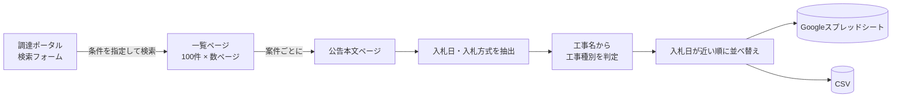

# 公共工事 入札公告 自動収集ツール

[](https://github.com/Takumi-Qz/japan-public-bid-scraper/actions/workflows/daily.yml)


国の機関が出す工事の入札公告を毎朝自動で集め、**「どの分野の工事か」で分類し、入札日が近い順に並べた一覧**にするツールです。
建設会社の営業担当が毎日ポータルサイトを見て回る手間をなくし、「自社が狙える案件」だけをすぐ絞り込めるようにします。

| | |
|---|---|
| 取得元 | [調達ポータル](https://www.p-portal.go.jp/)（デジタル庁が運営する政府調達の公式サイト） |
| 取得件数 | 1回の実行で **289件**（直近120日分の工事公告、取得失敗 0件） |
| 所要時間 | 約5分（サーバー負荷に配慮し、1秒に1リクエストまで） |
| 出力先 | Googleスプレッドシート／CSV |
| 更新 | GitHub Actions で毎朝7時に自動実行し、[data/bids.csv](data/bids.csv) を更新 |

## 出力イメージ

- 最新データ（毎朝自動更新）：[data/bids.csv](data/bids.csv)（GitHub上でそのまま表として見られます）
- スプレッドシートへの出力例：[入札公告一覧（Googleスプレッドシート）](https://docs.google.com/spreadsheets/d/15FQNUf0lpoSWqnvyJOyTowjMeDBaekS2iMZln37--zk/edit)（2026年10月24日時点のスナップショット）

| 入札日 | 工事種別 | 工事名 | 発注者 | 地域 | 入札方式 |
|---|---|---|---|---|---|
| 2026/10/26 | 建築 | 令和8年度宮城刑務所仙台拘置支所小荷物昇降機改修工事 | 法務省 | 宮城県 | 一般競争入札 |
| 2026/10/26 | 管 | 令和7年度岩国刑務所処遇棟等衛生設備等改修工事 | 法務省 | 山口県 | 一般競争入札 |
| 2026/10/27 | 電気 | 門司港湾合同庁舎非常用発電設備分解整備工事 | 財務省 | 福岡県 | 一般競争入札 |
| 2026/10/29 | 管 | 令和8年度京都農林水産総合庁舎個別空調機更新工事 | 農林水産省 | 京都府 | 一般競争入札（総合評価） |
| 2026/11/26 | 土木 | 令和8年度飯舘村長泥地区環境再生事業ヤード造成等工事 | 環境省 | 福島県 | 一般競争入札（総合評価） |

列は全部で9つです：公告日／入札日／発注者／工事名／工事種別／地域／入札方式／予定価格／URL（公告本文へのリンク）。

**工事種別の内訳**（289件）：建築 86・電気 47・管 35・土木 8・業務委託 73・その他 40。
設計や調査などの「業務委託」は独立した区分にしているので、工事会社はワンクリックで外せます。

## 仕組み



## 技術的なポイント

単純にページを取得するだけでは動かないサイトだったため、ブラウザの動きを再現しています。

| 課題 | 対応 |
|---|---|
| 検索がURLではなく、セキュリティトークン（CSRF）付きのフォーム送信でしか動かない | 検索画面のフォームを読み取り、ブラウザが送るのと同じ内容を組み立てて送信 |
| 2ページ目以降が、最初の検索をしたセッションでしか開けない | 1つのセッションを使い回し、検索→並び替え→ページ送りを順に実行 |
| 1回の検索で最大500件までしか表示されない | 期間を絞って上限内に収め、新しい順に並べ替えてから取得 |
| 入札日が決まった欄になく、公告本文の文章の中にしかない | 「開札日時」「入札書の提出期限」などの言い回しを探して日付を抜き出し、全角数字・和暦（令和）・PDF由来の空白にも対応 |
| 1件の取得失敗で全体が止まると、毎日の自動実行に向かない | ページ単位・案件単位で失敗を記録して処理を続行し、最後に成功/失敗件数を表示 |
| 毎日追記すると同じ案件が重複する | シートにある既存URLと照合し、新しい案件だけを追加 |

工事種別の判定ルールと日付の抽出は、テスト（[tests/test_main.py](tests/test_main.py)）で確認しています。

## できないこと（データ側の制約）

- **入札日**：取れるのは約3割（289件中91件）です。残りの公告は本文が「発注機関のホームページを参照」というリンクだけで、日付が載っていません。空欄の案件はURLから公告を確認してください。
- **予定価格**：国の工事では非公表が一般的なので、ほとんどの案件で空欄です。本文に金額が書かれている場合だけ取得します。
- 対象は調達ポータルに載る国の機関の案件です。都道府県・市区町村の入札は対象外です。

## 応用できること

同じ手法で、ログインなしで見られる公開サイトなら、検索・ページ送り・詳細ページの取得から整形・分類・定期実行まで一通り対応できます。
例：自治体の入札情報、求人情報、不動産・中古車の掲載情報、競合の価格調査など。

## 使い方

```sh
python3 -m venv .venv && source .venv/bin/activate
pip install -r requirements.txt

python main.py --csv data/bids.csv   # CSVに出力（設定不要）
python main.py --csv out.csv 改修     # 工事名に「改修」を含む案件だけ
DAYS=60 python main.py --csv out.csv # 遡る日数を変更（既定120日）
python -m unittest                   # テスト
```

### Googleスプレッドシートに出力する場合

1. Google Cloud でサービスアカウントを作り、Google Sheets API を有効にしてから、JSONキーを `service_account.json` として保存
2. 出力先のスプレッドシートを、サービスアカウントのメールアドレスに「編集者」で共有
3. `cp .env.example .env` で作った `.env` に `SPREADSHEET_ID` を書いて `python main.py` を実行

シートがなければヘッダー付きで自動作成し、新しい案件だけを追記します。
GitHub Actions でも追記したい場合は、リポジトリの Secrets に `SPREADSHEET_ID`・`SHEET_NAME`・`SERVICE_ACCOUNT_JSON`（JSONキーの中身）を登録してください。登録しなければCSVの更新だけが行われます。

## ファイル構成

```
main.py                     収集・抽出・分類・出力の本体
tests/test_main.py          判定ロジックのテスト
data/bids.csv               最新の収集結果（毎朝自動更新）
.github/workflows/daily.yml 毎朝7時（JST）の自動実行
requirements.txt / .env.example
```

## アクセスについて

取得するのは誰でも閲覧できる公開情報だけで、ログインが必要な機能は使っていません。リクエストの間に必ず1秒の間隔を空け、サイトに負荷がかからないようにしています。
